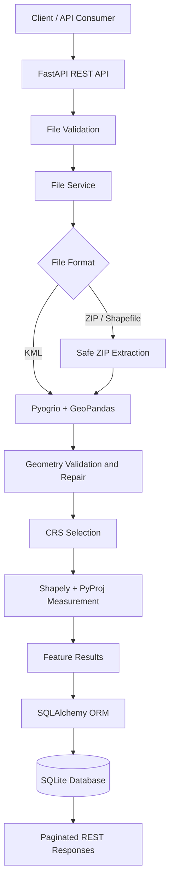

# 🌍 Geospatial File Measurement API

**A production-oriented FastAPI backend for processing geospatial files and calculating accurate area and length measurements using coordinate reference systems (CRS).**

[](https://www.python.org/)
[](https://fastapi.tiangolo.com/)
[](https://shapely.readthedocs.io/)
[](https://geopandas.org/)
[](https://www.sqlalchemy.org/)
[](https://www.docker.com/)
[](LICENSE)

---

## 📌 Overview

The **Geospatial File Measurement API** is a RESTful backend service that accepts KML files and ZIP archives containing ESRI Shapefiles, extracts their vector features, and calculates accurate spatial measurements.

It uses **GeoPandas, Shapely, PyProj, and Pyogrio** to process geometries, handle coordinate reference systems, repair invalid shapes, and compute measurements in meaningful physical units.

The service exposes clean REST endpoints for uploading files, retrieving metadata, and accessing paginated feature-level measurements.

### ✨ Key Highlights

- 📂 **Multiple input formats:** KML and zipped Shapefiles.
- 📐 **Accurate measurements:** Polygon areas in square metres and line lengths in metres.
- 🌐 **CRS-aware calculations:** Automatic projected CRS selection with UTM, equal-area projections, and geodesic measurements.
- 🛡️ **Secure file processing:** Upload size validation, ZIP Slip protection, and Shapefile sidecar validation.
- 🔧 **Geometry handling:** Z-coordinate stripping, invalid geometry repair, and empty geometry detection.
- ⚡ **Efficient processing:** Fast geospatial I/O, cached coordinate transformers, and bulk database inserts.
- 🗄️ **Persistent storage:** SQLAlchemy ORM with SQLite by default.
- 📖 **Interactive API documentation:** Swagger UI and OpenAPI support.
- 🐳 **Docker-ready:** Containerized deployment with environment-based configuration.
- 🧪 **Automated testing:** Tests for file validation, geometry calculations, CRS selection, and API responses.

---

## 🏗️ Architecture

The project follows a layered architecture that separates HTTP handling, business logic, geospatial processing, and data persistence.



### 🔄 Processing Pipeline

1. **Validate** the uploaded file's extension, size, and content.
2. **Store** the file using a generated UUID rather than its original filename.
3. **Extract** vector features from every supported KML layer or the uploaded Shapefile archive.
4. **Validate** the source CRS and ensure that features are available.
5. **Normalize** geometries, strip Z coordinates, and repair invalid shapes where possible.
6. **Select** a suitable projected CRS or geodesic measurement strategy.
7. **Calculate** polygon areas and line lengths while preserving feature properties.
8. **Persist** file metadata and feature-level results in the database.
9. **Expose** results through paginated REST endpoints.

---

## 🛠️ Tech Stack

| Technology | Purpose |
|---|---|
| Python 3.11+ | Core programming language |
| FastAPI | REST API framework |
| Pydantic v2 | Request validation and response schemas |
| GeoPandas | Geospatial data processing |
| Pyogrio | Efficient vector file I/O |
| Shapely 2.x | Geometry operations, validation, and repair |
| PyProj | CRS transformations and geodesic calculations |
| SQLAlchemy | ORM and database access |
| SQLite | Lightweight persistent storage |
| Pytest | Automated testing |
| Docker | Containerization |

---

## 📁 Project Structure

```text
geospatial-measurement-api/
├── app/
│   ├── main.py
│   ├── api/
│   │   └── routes/
│   │       └── files.py
│   ├── core/
│   │   ├── config.py
│   │   └── exceptions.py
│   ├── db/
│   │   ├── database.py
│   │   └── models.py
│   ├── schemas/
│   │   └── file.py
│   ├── services/
│   │   ├── file_service.py
│   │   ├── geospatial_service.py
│   │   ├── crs_service.py
│   │   └── measurement_service.py
│   └── utils/
│       └── file_utils.py
├── sample_data/
│   └── make_samples.py
├── tests/
├── storage/
├── .env.example
├── .gitignore
├── Dockerfile
├── requirements.txt
└── README.md
```

---

## 🚀 Getting Started

### Prerequisites

- Python 3.11 or later
- Git
- Docker (optional)

### 1. Clone the Repository

```bash
git clone https://github.com/<your-username>/geospatial-measurement-api.git
cd geospatial-measurement-api
```

### 2. Create a Virtual Environment

**Windows**

```powershell
python -m venv .venv
.venv\Scripts\activate
```

**macOS / Linux**

```bash
python3 -m venv .venv
source .venv/bin/activate
```

### 3. Install Dependencies

```bash
python -m pip install --upgrade pip
pip install -r requirements.txt
```

### 4. Configure Environment Variables

Create a local `.env` file from the example configuration.

```bash
# macOS / Linux
cp .env.example .env
```

On Windows, use:

```powershell
Copy-Item .env.example .env
```

Update the environment variables if required. Refer to `app/core/config.py` for the supported configuration options.

### 5. Generate Sample Files

```bash
python sample_data/make_samples.py
```

This step is optional if you already have test KML files or zipped Shapefiles.

### 6. Start the Server

```bash
uvicorn app.main:app --reload
```

The API will be available at:

| Resource | URL |
|---|---|
| API base URL | http://localhost:8000 |
| Swagger UI | http://localhost:8000/docs |
| ReDoc | http://localhost:8000/redoc |
| Health check | http://localhost:8000/health |

---

## 🐳 Running with Docker

Build the Docker image:

```bash
docker build -t geospatial-api .
```

Run the container:

```bash
docker run --rm -p 8000:8000 \
  -e MAX_UPLOAD_MB=50 \
  -e DATABASE_URL=sqlite:///./geospatial.db \
  geospatial-api
```

Open [http://localhost:8000/docs](http://localhost:8000/docs) to explore the API.

> **Note:** Ensure the database and upload storage directories are writable and mounted to persistent volumes when required. For production deployments, configure the database URL, upload limits, and storage strategy explicitly.

---

## 📡 API Reference

### 1. Upload and Process a File

`POST /api/files/`

Accepts a KML file or ZIP archive containing a Shapefile.

**Example request**

```bash
curl -X POST "http://localhost:8000/api/files/" \
  -F "file=@sample_data/sample.kml"
```

**Example response — `201 Created`**

```json
{
  "id": "c9bf9e57-1685-4c89-bafb-ff5af830be8a",
  "filename": "sample.kml",
  "feature_count": 3,
  "crs": "EPSG:4326",
  "status": "COMPLETED"
}
```

**Possible errors**

| Status | Description |
|---|---|
| `413` | Uploaded file exceeds the configured size limit |
| `415` | Unsupported file extension |
| `422` | Invalid file, missing CRS metadata, missing Shapefile `.prj`, or no features |
| `400` | Corrupt ZIP archive |

ZIP extraction is validated to prevent path traversal attacks. Shapefile uploads must contain the required companion files, including `.shp`, `.shx`, `.dbf`, and `.prj`.

### 2. Retrieve File Metadata

`GET /api/files/{id}/`

Returns metadata and processing status for an uploaded file.

```bash
curl "http://localhost:8000/api/files/<file-id>/"
```

**Example response — `200 OK`**

```json
{
  "id": "c9bf9e57-1685-4c89-bafb-ff5af830be8a",
  "filename": "sample.kml",
  "feature_count": 3,
  "crs": "EPSG:4326",
  "status": "COMPLETED",
  "error_message": null,
  "created_at": "2026-10-09T00:40:00Z"
}
```

### 3. Retrieve Feature Measurements

`GET /api/files/{id}/measurements/?limit=50&offset=0`

Returns paginated feature-level geometry and measurement results.

```bash
curl "http://localhost:8000/api/files/<file-id>/measurements/?limit=10&offset=0"
```

**Example response — `200 OK`**

```json
{
  "file_id": "c9bf9e57-1685-4c89-bafb-ff5af830be8a",
  "total": 3,
  "limit": 10,
  "offset": 0,
  "results": [
    {
      "index": 0,
      "geometry_type": "Polygon",
      "geometry": {
        "type": "Polygon",
        "coordinates": [
          [
            [77.10, 28.70],
            [77.11, 28.70],
            [77.11, 28.71],
            [77.10, 28.71],
            [77.10, 28.70]
          ]
        ]
      },
      "properties": {
        "name": "Plot A",
        "zone": "Commercial"
      },
      "source_crs": "EPSG:4326",
      "measurement": {
        "type": "area",
        "value": 1073842.25,
        "unit": "m2"
      },
      "crs_used": "EPSG:32643",
      "status": "OK",
      "note": null
    },
    {
      "index": 1,
      "geometry_type": "LineString",
      "geometry": {
        "type": "LineString",
        "coordinates": [
          [77.10, 28.70],
          [77.12, 28.72],
          [77.14, 28.70]
        ]
      },
      "properties": {
        "name": "Road 1"
      },
      "source_crs": "EPSG:4326",
      "measurement": {
        "type": "length",
        "value": 4342.18,
        "unit": "m"
      },
      "crs_used": "EPSG:32643",
      "status": "OK",
      "note": null
    },
    {
      "index": 2,
      "geometry_type": "Point",
      "geometry": {
        "type": "Point",
        "coordinates": [77.10, 28.70]
      },
      "properties": {
        "name": "Marker A"
      },
      "source_crs": "EPSG:4326",
      "measurement": null,
      "crs_used": null,
      "status": "OK",
      "note": "No measurement for point geometries."
    }
  ]
}
```

**Measurement behavior**

| Geometry | Measurement | Unit |
|---|---|---|
| Polygon | Area | m² |
| MultiPolygon | Combined area | m² |
| LineString | Length | m |
| MultiLineString | Combined length | m |
| Point / MultiPoint | Not applicable | — |
| Empty geometry | Skipped | — |
| Unsupported geometry | Not calculated | — |

**Additional error responses**

| Status | Description |
|---|---|
| `404` | File ID does not exist |
| `409` | File has not completed processing |

### 4. Health Check

`GET /health`

```bash
curl "http://localhost:8000/health"
```

Example response:

```json
{
  "status": "healthy",
  "version": "1.0.0"
}
```

---

## 🌐 Coordinate Reference Systems (CRS)

Accurate geospatial measurement requires converting geographic coordinates into a suitable measurement model.

Longitude and latitude are angular coordinates, not linear units. Calculating polygon area or line length directly from degree-based coordinates produces results in inappropriate units.

This service selects a measurement strategy based on the source CRS and geometry extent.

| Scenario | Strategy | Purpose |
|---|---|---|
| Source CRS uses metres | Use the source projection | Avoid unnecessary transformations |
| Local geographic dataset | Suitable UTM zone | Accurate local area and distance calculations |
| Polygon spanning multiple UTM zones | EPSG:6933 | Equal-area measurement |
| Long line spanning multiple zones | WGS84 geodesic calculation | Ellipsoidal distance calculation |

### Key Implementation Details

- **Axis order:** Uses `always_xy=True` for consistent longitude/latitude coordinate ordering.
- **Z-coordinate handling:** Removes altitude coordinates before 2D measurements.
- **Geometry repair:** Uses Shapely's `make_valid` for invalid geometries.
- **Transformer caching:** Reuses coordinate transformers through an LRU cache.
- **Property sanitization:** Converts NumPy scalars, timestamps, NaN, and other non-JSON-native values into serializable values.
- **CRS transparency:** Returns both the source CRS and the CRS used for each projected measurement where applicable.

> **Important:** The accuracy of a measurement depends on the selected CRS, the geographic extent, and the geometry's validity. For high-precision survey or legal cadastral work, validate results against domain-specific reference data.

---

## 🔐 Validation and Error Handling

The service applies validation at the upload and geometry-processing stages.

- File extensions are restricted to `.kml` and `.zip`.
- Empty uploads and files exceeding the configured limit are rejected.
- ZIP paths are checked to prevent ZIP Slip directory traversal.
- Shapefile archives are checked for required companion files and CRS metadata.
- KML processing accounts for multiple layers.
- Empty geometries are skipped, and invalid geometries are repaired when possible.
- Unsupported geometry types receive explicit status information.
- API errors use meaningful HTTP status codes and structured error handling.

---

## 🧪 Testing

Run the test suite:

```bash
pytest -v
```

Generate a coverage report:

```bash
pip install pytest-cov
pytest --cov=app --cov-report=term-missing
```

### Test Coverage Areas

| Module | Test scenarios |
|---|---|
| CRS service | UTM zone selection, hemisphere handling, multi-zone detection |
| Measurement service | Polygon area, line length, multipart geometries, empty and invalid shapes |
| Upload API | KML upload, 3D KML, zipped Shapefiles, missing `.prj`, ZIP Slip, invalid extensions |
| Validation API | File lookup, pagination, response structure, point measurements, health check |

---

## 💡 Design Decisions

### FastAPI and a Layered Architecture

Route handlers focus on HTTP concerns while services own file processing, CRS selection, geometry measurements, and persistence. This improves separation of concerns and testability.

### Pyogrio over Fiona

Pyogrio provides efficient vector-data I/O and commonly available binary wheels, reducing setup friction while improving performance for supported formats.

### SQLite and SQLAlchemy

SQLite provides a lightweight local database without requiring a separate server. SQLAlchemy separates persistence logic from database-specific implementation details.

### Synchronous Processing

Processing occurs during the upload request, keeping the initial architecture simple. Background workers are a future improvement for long-running jobs and higher concurrency.

### Rejecting Shapefiles Without `.prj`

A Shapefile without CRS metadata cannot be interpreted reliably. Rejecting it prevents silent coordinate-system assumptions that could produce incorrect measurements.

---

## 🚧 Future Improvements

- [ ] Background processing with Celery or RQ and Redis.
- [ ] PostgreSQL/PostGIS support for spatial indexing and native spatial queries.
- [ ] Additional formats: GeoJSON, GeoPackage, FlatGeobuf, and DXF.
- [ ] Optional CRS override for known source coordinate systems.
- [ ] Authentication and authorization for multi-user deployments.
- [ ] Streaming uploads and resource limits for large datasets.
- [ ] Alembic database migrations.
- [ ] OpenTelemetry instrumentation and structured logging.
- [ ] Map previews and geometry visualization.
- [ ] Robust antimeridian-crossing geometry handling.
- [ ] Stronger concurrency and integration testing.

---

## 📚 Key Learnings

1. **CRS awareness is essential:** Geographic coordinates must be handled with an appropriate projection or geodesic model for meaningful measurements.
2. **Geometry repair changes geometry types:** An invalid Polygon may become a MultiPolygon or GeometryCollection after repair.
3. **KML files can contain multiple layers:** Reading only the default layer may omit features.
4. **Shapefile data is distributed across companion files:** Missing CRS or geometry metadata can make reliable interpretation impossible.
5. **Geospatial data needs JSON sanitization:** Pandas and NumPy types are not always directly serializable.
6. **File security matters:** Archive extraction requires path validation and resource limits, even in data-processing APIs.

---

## 🤝 Contributing

Contributions, issues, and suggestions are welcome.

1. Fork the repository.
2. Create a feature branch: `git checkout -b feature/your-feature`.
3. Add tests for your changes.
4. Run `pytest -v`.
5. Submit a pull request.

---

## 📄 License

This project is licensed under the MIT License. See the [LICENSE](LICENSE) file for details.

---

## 👨‍💻 Author

**Tushar Sourav**

2026 B.E. Computer Science graduate | Backend Development | Applied AI

- GitHub: [@Uzumaki-tushar](https://github.com/Uzumaki-tushar)
- LinkedIn: [Tushar Sourav](https://www.linkedin.com/)

---

⭐ If you find this project useful, consider giving the repository a star.